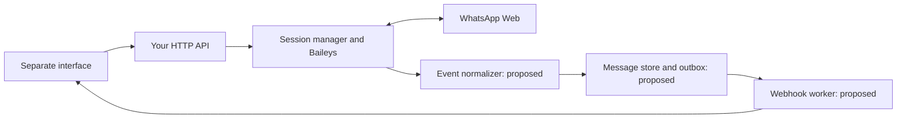

# Baileys capabilities and expansion options

Reviewed: **31 October 2026, Asia/Kolkata**. Project baseline: **`@whiskeysockets/baileys` `7.0.0-rc14`**.

> Historical analysis from before media, location, contact-card, and poll
> sending was implemented. For current supported requests and usage, see the
> [message API guide](docs/MESSAGE_API.md). Capability descriptions below
> describe the server at the time of this analysis.

This report reviews the [Baileys repository](https://github.com/WhiskeySockets/Baileys) and [official documentation](https://baileys.wiki/), then compares their capabilities with this server. It is an analysis document: no application code, dependencies, sessions, or interface files were changed, and no live feature tests were performed.

**Recommendation:** extend the server into a two-way gateway by adding a message store, incoming-message webhooks, and delivery/read tracking. Media sending is the next useful expansion. These additions give your separate interface a conversation workflow rather than only an outgoing text request.

## 1. What your server already provides

The following was verified from the local routes, controller, connection manager, and package configuration.

| Existing capability | Current behavior |
| --- | --- |
| Individual text messages | `POST /api/send` accepts a country-code phone number and text. It returns a message ID when Baileys supplies one. |
| Shared API key | `/api` requests and QR-data requests use `x-api-key`. |
| QR pairing page | `GET /qr` serves the page; the user enters the key to request pairing data. |
| QR payload for another service | `POST /qr` returns raw QR text, an image, and timestamps. `GET /qr/status` reads the current pairing state. |
| WhatsApp readiness | `GET /ping` distinguishes connected from unavailable states. |
| Connection recovery | Backoff, terminal-error handling, credential-save coordination, and protected QR refresh. |
| Saved authentication | One linked account, one global socket, and local file-based auth. |

The HTTP API currently has no incoming-message feed, durable conversation database, delivery-status query, media endpoint, group operations, pairing-code endpoint, or independent-account registry. Its phone formatter deliberately accepts individual phone numbers; it cannot address groups or opaque WhatsApp identities.

Local evidence: [app.js](app.js), [message routes](routes/messageRoutes.js), [send controller](controllers/sendMessage.js), [QR routes](routes/qrRoutes.js), [connection manager](config/socket.js), and [package.json](package.json).

## 2. Additional messaging capabilities

The capabilities below are documented and corroborated by the installed rc14 API/types. They still need routes, validation, storage where applicable, and real-account acceptance tests in your application.

### Media and structured content

| Addition | Baileys interface | What your interface could offer |
| --- | --- | --- |
| Images | `sendMessage(jid, { image, caption })` | Send a photo with accompanying text. |
| Video | `{ video, caption }` | Send video attachments; `gifPlayback` supports GIF-style playback of a suitable video. |
| Audio and voice notes | `{ audio, mimetype, ptt }` | Send audio files or push-to-talk voice messages. |
| Documents | `{ document, mimetype, fileName }` | Send PDFs, invoices, and other supported attachments. |
| Stickers | `{ sticker }` | Send suitably encoded stickers. |
| Download received attachments | `downloadMediaMessage(...)`, `updateMediaMessage` | Retrieve incoming files for display or processing. |

Media can be supplied as buffers, streams, or URL-based inputs. Encoding matters: voice-note audio and GIF-style video need appropriate formats. Downloadable media can expire; a re-upload request depends on a device retaining it. Your server would own upload handling, size/type limits, conversion, and storage. These behaviors are described in the [media guide](https://baileys.wiki/messaging/media-messages); the [rc14 message types](https://github.com/WhiskeySockets/Baileys/blob/v7.0.0-rc14/src/Types/Message.ts) provide the version-specific contract.

| Addition | Baileys interface | Important condition |
| --- | --- | --- |
| Static location pins | `{ location: { degreesLatitude, degreesLongitude } }` | A map location is different from continuous live-location sharing. |
| Contact cards | `{ contacts: { displayName, contacts: [{ vcard }] } }` | Construct and validate the contact card. |
| Quoted replies and forwarding | Send options `{ quoted: originalMessage }`; content `{ forward: originalMessage }` | Keep the original message and key. |
| Mentions and reactions | `mentions: [jid]`; `{ react: { key, text } }` | Preserve the correct identities and target message key. |
| Polls | `{ poll: { name, values, selectableCount } }` | Vote processing needs the original poll message. |
| Disappearing-message settings | `disappearingMessagesInChat`; `ephemeralExpiration` | Separate a chat's timer policy from individual send options. |

These content types are covered by the [sending guide](https://baileys.wiki/messaging/sending-messages). Poll aggregation uses `getAggregateVotesInPollMessage(...)`; it should be implemented together with message persistence, rather than treated as a text-only send variant.

### Message actions

You can expose editing, deletion for everyone, read acknowledgements, and message pinning. The relevant operations include `{ text, edit: original.key }`, `{ delete: original.key }`, and `readMessages([key])`. WhatsApp applies its own permissions and eligibility rules; an HTTP request cannot bypass those rules. The [message-actions guide](https://baileys.wiki/messaging/message-actions) describes the core operations. Pinning payloads require the rc14-specific shape noted in section 7.

## 3. Receiving messages, receipts, and conversation history

### A two-way inbox

Baileys already emits messages and changes through `sock.ev`. Useful subscriptions include:

| Baileys event | Possible server/interface feature |
| --- | --- |
| `messages.upsert` | Incoming messages and messages synchronized from another device. |
| `messages.update` | Message-state changes and poll updates. |
| `message-receipt.update` | Recipient-specific delivery/read information. |
| `messages.reaction`, `messages.delete` | Keep reactions and deletions synchronized. |
| `chats.upsert/update/delete`, `contacts.upsert/update` | Maintain a contact and conversation list. |
| `connection.update` | Notify the interface when the session disconnects or needs pairing. |

Process every message in each batch, retain `fromMe`, distinguish new notifications from history/appended data, and deduplicate before triggering workflows. The [events guide](https://baileys.wiki/concepts/events) and [rc14 event map](https://github.com/WhiskeySockets/Baileys/blob/v7.0.0-rc14/src/Types/Events.ts) define these inputs.

**Application addition:** transform those events into authenticated webhooks, Server-Sent Events, or WebSocket updates for your interface. Baileys does not automatically host these transports or manage webhook retries.

### Delivery and read tracking

The server's current send success means the send call completed. A useful upgrade is a stored lifecycle such as accepted, pending, server-acknowledged, delivered, read, played, or failed. Group messages may need a status per participant. Missing receipts should remain unknown rather than become a fabricated delivery or read result.

Use the library's symbolic status values. In rc14, `proto.WebMessageInfo.Status` / `WAMessageStatus` maps as follows:

| Name | Value |
| --- | ---: |
| `ERROR` | 0 |
| `PENDING` | 1 |
| `SERVER_ACK` | 2 |
| `DELIVERY_ACK` | 3 |
| `READ` | 4 |
| `PLAYED` | 5 |

The authoritative versioned definition is in [rc14 protocol declarations](https://github.com/WhiskeySockets/Baileys/blob/v7.0.0-rc14/WAProto/index.d.ts). The wiki's numeric example differs; see section 7.

### Persistent messages and history

Build your own message/chat/contact store; the old `makeInMemoryStore` helper is absent in rc14. Configure `getMessage(key)` to retrieve original message content for protocol recovery and poll processing. Persist outbound content too, not just inbound messages. Baileys has a recent-message retry cache, so absence of a custom store does not imply every immediate retry fails; a persistent fallback matters across cache misses and restarts. The [data-store guide](https://baileys.wiki/concepts/data-store), [socket configuration](https://baileys.wiki/concepts/socket-config), and [rc14 receiver implementation](https://github.com/WhiskeySockets/Baileys/blob/v7.0.0-rc14/src/Socket/messages-recv.ts) establish this distinction.

History arrives asynchronously through `messaging-history.set`. `fetchMessageHistory(...)` requests older batches; it is not a database pagination endpoint returning an unlimited archive. Your stored messages would power normal inbox pagination and search. Sync settings and a suitable desktop browser identity influence requested history, but available data remains subject to WhatsApp's synchronization behavior. See [history sync](https://baileys.wiki/advanced/history-sync).

## 4. Groups, contacts, and account features

| Addition | Relevant APIs | Scope and conditions |
| --- | --- | --- |
| Group messaging and management | `groupCreate`, `groupMetadata`, `groupFetchAllParticipating`, `groupParticipantsUpdate`, `groupLeave` | Address group JIDs; add/remove/promote/demote participants when permitted. Inspect participant-level results. |
| Group configuration | `groupUpdateSubject`, `groupUpdateDescription`, `groupSettingUpdate`, `groupToggleEphemeral` | Name, description, posting/edit permissions, and timers. Many changes require admin rights. |
| Invitations and approval | `groupInviteCode`, `groupRevokeInvite`, `groupAcceptInvite`, `groupRequestParticipantsUpdate` | Join/invite and pending-member workflows, with permissions. |

The [groups guide](https://baileys.wiki/features/groups) and [rc14 group implementation](https://github.com/WhiskeySockets/Baileys/blob/v7.0.0-rc14/src/Socket/groups.ts) support these operations. A group feature should also cache metadata and refresh it when group or participant events arrive; `cachedGroupMetadata` is covered in [socket configuration](https://baileys.wiki/concepts/socket-config).

| Addition | Relevant APIs | Scope and conditions |
| --- | --- | --- |
| Check a number and enrich a contact | `onWhatsApp`, `profilePictureUrl`, `fetchStatus`, `getBusinessProfile` | Profile details can be unavailable. `fetchStatus` retrieves profile/About information, not a Status-story feed. |
| Organize conversations | `chatModify`, `star` | Archive, mute, mark read/unread, pin chats, star messages, and local clearing/deletion. Some patches require recent message keys/timestamps. |
| Update the linked profile | `updateProfileName`, `updateProfileStatus`, `updateProfilePicture`, `removeProfilePicture` | Changes the actual linked account. Expose as a deliberate account-control operation. |

These functions are described by [chat management](https://baileys.wiki/messaging/chat-management) and the [rc14 chats implementation](https://github.com/WhiskeySockets/Baileys/blob/v7.0.0-rc14/src/Socket/chats.ts). Message-aware operations should use stored context; the rc14 delete-for-me shape differs from a wiki example.

| Addition | Relevant APIs | Scope and conditions |
| --- | --- | --- |
| Typing, recording, and presence | `sendPresenceUpdate`, `presenceSubscribe`, `presence.update` | Useful for an active conversation UI. These are transient signals, not reliable continuous monitoring. |
| Privacy and blocking | `fetchPrivacySettings`, `fetchBlocklist`, `updateBlockStatus`, privacy-update methods | Manage settings of the linked account; privacy restrictions still apply to other accounts' information. |
| Status stories | `sendMessage('status@broadcast', ..., { statusJidList })` | Publish to an explicitly managed audience; different from sending an ordinary individual message. |

These areas are documented in [presence](https://baileys.wiki/features/presence), [privacy](https://baileys.wiki/features/privacy), and [broadcasts and stories](https://baileys.wiki/features/broadcasts-stories). Existing broadcast-list APIs need separate verification on rc14; they should not be inferred from Status support.

## 5. Authentication and more than one account

**Pairing by code:** `requestPairingCode(phoneNumber, customPairingCode?)` offers an alternative to QR scanning. Use an unregistered session, wait for appropriate connection readiness, and supply a country-code number containing digits only. For rc14, describe the result as an **eight-character code**: it may contain letters. The [pairing guide](https://baileys.wiki/authentication/pairing-code) describes the flow, while the [rc14 socket implementation](https://github.com/WhiskeySockets/Baileys/blob/v7.0.0-rc14/src/Socket/socket.ts) determines the actual code generation.

**Multiple independent accounts:** this is achievable by managing separate sockets and authentication states. Your application would need a session registry, account-specific pairing/status, scoped credentials, and routing for every send, event, and stored record. The current global `getSocket()` is a single-account interface; a session manager would be new server architecture. Keep the existing `/api/send` mapped to a default session if backward compatibility is important.

**Database-backed authentication:** the [session-management guide](https://baileys.wiki/authentication/session-management) recommends custom durable auth storage for production use. Such a store must preserve both credentials and Signal-key updates, including binary data. If several processes serve the API, assign one active owner to each WhatsApp session. That ownership design is an application recommendation, not a built-in multitenant service supplied by Baileys.

## 6. Advanced capabilities worth evaluating separately

The following are present in the installed rc14 source/API, but source availability is not proof of successful operation with every account or client. Treat them as optional, version-sensitive additions requiring focused live validation.

| Candidate | Source-confirmed surface | Evaluation note |
| --- | --- | --- |
| Business catalogs and products | `getCatalog`, `getCollections`, `getOrderDetails`, `productCreate`, `productUpdate`, `productDelete` | Requires suitable account capabilities and permissions. Order lookup is not payment processing. [Business source](https://github.com/WhiskeySockets/Baileys/blob/v7.0.0-rc14/src/Socket/business.ts). |
| Business labels and quick replies | `addChatLabel`, `addMessageLabel`, `addOrEditQuickReply`, related removal methods | Account-sensitive app-state features. Your own interface can also maintain its own labels/canned replies independently. [Chats source](https://github.com/WhiskeySockets/Baileys/blob/v7.0.0-rc14/src/Socket/chats.ts). |
| Channels/newsletters | `newsletterCreate`, `newsletterMetadata`, `newsletterFollow`, `newsletterFetchMessages`, `newsletterReactMessage` | Dedicated identifiers and channel permissions apply. [Newsletter source](https://github.com/WhiskeySockets/Baileys/blob/v7.0.0-rc14/src/Socket/newsletter.ts). |
| Communities | `communityCreate`, `communityCreateGroup`, `communityLinkGroup`, `communityFetchLinkedGroups` | Separate community/admin workflows. [Communities source](https://github.com/WhiskeySockets/Baileys/blob/v7.0.0-rc14/src/Socket/communities.ts). |
| Calendar-style event content and albums | `event`, `album`, `albumParentKey` | Typed candidates that need client compatibility testing. [Message types](https://github.com/WhiskeySockets/Baileys/blob/v7.0.0-rc14/src/Types/Message.ts). |
| Incoming-call handling | `call` event, `rejectCall`; source also exposes `createCallLink` | Call detection/rejection and join links are different from answering calls. The [calls guide](https://baileys.wiki/advanced/calls) does not offer voice/video media transport or a voice-agent calling API. |

A business inbox, attachment workflow, rule-based assistant, or AI-assisted reply flow could use these transport features. The business rules, model integration, approvals, assignments, and reporting would be separate application features you build; Baileys does not supply them automatically.

## 7. Documentation mismatches and limits found during review

| Topic | Finding for your pinned rc14 version |
| --- | --- |
| Receipt numbers | The wiki events example labels status numbers differently from the installed protocol enum. Use symbolic names and the table in section 3. [Wiki example](https://baileys.wiki/concepts/events), [versioned protocol](https://github.com/WhiskeySockets/Baileys/blob/v7.0.0-rc14/WAProto/index.d.ts). |
| Pairing-code characters | The guide says eight digits; rc14 generates an eight-character Crockford-base32 code. Do not validate it as numeric-only. [Guide](https://baileys.wiki/authentication/pairing-code), [socket source](https://github.com/WhiskeySockets/Baileys/blob/v7.0.0-rc14/src/Socket/socket.ts). |
| Pinning a message | A wiki example nests the fields. rc14 expects the message key in `pin`, with sibling `type` and `time` fields. [Sending guide](https://baileys.wiki/messaging/sending-messages), [message type](https://github.com/WhiskeySockets/Baileys/blob/v7.0.0-rc14/src/Types/Message.ts). |
| Delete for me | The chat guide's `clear: { messages: [...] }` example does not match rc14's `ChatModification`. rc14 has `deleteForMe: { deleteMedia, key, timestamp }`, or `clear: boolean` with `lastMessages`. [Chat guide](https://baileys.wiki/messaging/chat-management), [chat type](https://github.com/WhiskeySockets/Baileys/blob/v7.0.0-rc14/src/Types/Chat.ts). |
| Broadcast-list lookup | `getBroadcastListInfo` appears in the wiki but was not found in the installed rc14 library. Treat existing-list lookup/sending/deletion as unverified for this server version. [Broadcast guide](https://baileys.wiki/features/broadcasts-stories). |
| Old in-memory store examples | `makeInMemoryStore` is absent in rc14. Design your own store rather than copying an old v6 snippet. [Store guide](https://baileys.wiki/concepts/data-store). |

Additional boundaries:

- Interactive button/list reply types do not establish a general supported outgoing menu/template API. Validate any proposed interactive flow against the pinned source and actual clients.
- Static-location support does not establish a supported continuous live-location sending API.
- Profile lookup and presence do not bypass another account's privacy settings.
- The reviewed sources do not establish unlimited historical export, guaranteed receipts, a universally safe sending rate, or exactly-once message delivery.

Baileys is an unofficial WhatsApp Web integration. The [project's own disclaimer](https://github.com/WhiskeySockets/Baileys#disclaimer) disclaims affiliation and discourages spam/bulk misuse; feature support should not be presented as WhatsApp authorization or a delivery guarantee.

The wiki also describes **v8 as active development**, including a different architecture and auth migration. That is future migration planning, not a reason to change this working rc14 server now. Consult the actual release and migration helper before a later upgrade. See [v8 migration](https://baileys.wiki/migration/v8).

## 8. Suggested implementation order

This ordering is an application-design recommendation based on your separate-interface setup. Effort is relative, not a time estimate.

| Order | Feature | Why it is useful | Relative effort |
| --- | --- | --- | --- |
| 1 | Message/identity store and receipt tracking | Establish a reliable message record and status lookup by session/chat/message key. | Medium |
| 2 | Incoming/status/connection webhooks | Let your other interface receive replies and account-state changes. Add a durable webhook outbox, retries, signatures, and event IDs. | Medium |
| 3 | Media send and download | Enable photos, documents, audio, and attachment workflows. | Medium |
| 4 | Request idempotency and outbound jobs | Prevent duplicate requests from casually producing duplicate sends; expose uncertain outcomes and failed jobs. | Medium |
| 5 | Pairing code | Offer an alternative onboarding path alongside QR. | Small to medium |
| 6 | Replies, reactions, editing, and read actions | Make the stored inbox usable for conversations. | Small to medium after storage |
| 7 | Groups and contact enrichment | Add group communication and address-book context where needed. | Medium |
| 8 | Independent account sessions and database auth | Expand to several accounts when the product actually needs them. | Large |
| 9 | Business, community, channel, and Status features | Add only the account-specific workflows relevant to your interface. | Variable; targeted validation required |

For the first expansion, a useful acceptance target is: **send one message, persist its full key/content, receive the reply, update its receipt state, and deliver those changes to the other interface even when that interface temporarily disconnects.**

## 9. Proposed API and integration design

**Every route in this table is a proposal. These routes were not implemented.** Retain the existing POST-only text-send route.

| Proposed route | Purpose |
| --- | --- |
| `POST /api/messages/media` | Upload/send an attachment with an explicit media type. |
| `GET /api/messages/:messageId/status` | Query persisted status, with session/chat context to disambiguate the ID. |
| `GET /api/chats` | List conversations from your own database. |
| `GET /api/chats/:jid/messages` | Paginate stored messages for a chat. |
| `POST /api/messages/:messageId/reply` | Reply using the stored original message/key. |
| `POST /api/messages/:messageId/reactions` | Add/remove a reaction through a mutating request. |
| `POST /api/webhooks` | Configure allowed callback destinations and event subscriptions. |
| `POST /api/pairing-code` | Request linked-device pairing by code for an unregistered session. |
| `POST /api/sessions` | Create an independent account session when multiple accounts are introduced. |
| `GET /api/sessions/:sessionId/status` | Read account-specific readiness and pairing state. |
| `POST /api/groups/:jid/participants` | Perform an explicit, permission-checked participant operation. |

The future data flow could look like this:

For the message store, keep `sessionId`, the original chat JID, full message key, direction, message content, timestamps, and receipt records. For groups, preserve the participant identity. Use Baileys-aware serialization for binary message fields. Keep message data separate from authentication secrets.

Identifiers need special attention in v7: individual phone-number JIDs, opaque `@lid` identities, group `@g.us` identities, and newsletter addresses are not interchangeable. Persist known alternate mappings; do not reconstruct a phone number by stripping characters from a LID. The [JID guide](https://baileys.wiki/concepts/jids) and [v7 migration guide](https://baileys.wiki/migration/v7) explain these changes.

Protocol resend requests and retries of your HTTP jobs are different mechanisms. After an ambiguous network timeout, mark the outcome uncertain and reconcile by stored IDs/events rather than blindly sending again. A webhook should have its own stable event ID so the receiving service can deduplicate it. These are application reliability choices, not guarantees the underlying transport makes.

## 10. Scope of this analysis

- Only this Markdown file was added. No feature endpoints were implemented.
- The server was not started; no messages, calls, profile changes, or pairing operations were performed.
- Authentication contents were not inspected or modified.
- `cloudflare-interface` was not analyzed or changed.
- No Git commit or push was performed for this report.
- Documentation and source/type inspection establish candidate capabilities; live behavior of the additional features remains untested.

The versioned GitHub links refer to the installed rc14 tag, while the wiki is a moving documentation source. Recheck the relevant tagged API and client behavior when implementing a selected feature.
