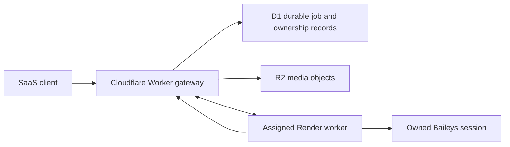

# Proposed Cloudflare gateway integration

This document defines the migration plan and proposed contracts for a future
Cloudflare Workers + D1 gateway. The current Render worker operates locally
without Cloudflare, Redis, or a database. **No gateway deployment, endpoint URL,
Cloudflare credential, durable claim loop, or D1 schema is provisioned by this
change.** The interfaces are extension points; they do not make local jobs
durable. See [local queue operation](QUEUE.md) and
[message request formats](MESSAGE_API.md).

## Responsibility boundary

| Component | Owns |
| --- | --- |
| Cloudflare gateway | Client authentication, tenant authorization, durable idempotency, globally unique IDs, quotas, session allocation, durable admission, lease coordination, authoritative status |
| D1 | Job and attempt metadata, tenant/session relationships, status versions, ownership tokens/fences, retry timing, and idempotency records |
| R2 | Durable media objects and their retention lifecycle; D1 stores object references and small metadata |
| Render worker | One assigned Baileys session, bounded local admission, media validation/staging, FIFO execution, send pacing, safe local retries, result and receipt reporting |

D1 is accessed by the gateway through its Worker binding. The Render process
must communicate through an authenticated gateway transport, never by adding
direct D1 credentials or database access. Cloudflare documents the binding
and transaction behavior in the [D1 database API](https://developers.cloudflare.com/d1/worker-api/d1-database/).

The current static `x-api-key` worker interface trusts the caller with all
local jobs. It does not prove a SaaS tenant identity. Keep it behind the
authorized gateway before serving multiple tenants. A session ID or job ID
supplied by a client must never grant ownership by itself.

## Coordinator interface

`services/gatewayCoordinator.js` provides an injected-transport boundary for
the following operations. An eventual HTTP transport supplies deployment
URLs, authentication, timeouts, and request serialization after the gateway
contract has been agreed and deployed. Local development does not call it.

| Method | Intended operation |
| --- | --- |
| `claimJobs` | Atomically obtain a bounded set of eligible jobs for an authorized worker/session |
| `acknowledgeClaim` | Confirm receipt of a claim before executing it |
| `updateProcessingStatus` | Record a processing phase and version while ownership is current |
| `reportSendResult` | Record a send ID, success, permanent failure, or ambiguous outcome |
| `renewLease` | Extend an existing unexpired claim without changing its owner/fence |
| `releaseRetryable` | Return a job to eligible retry state only when no send may have occurred |
| `recoverExpiredClaims` | Recover expired ownership according to recorded send phase |

The CommonJS factory is
`createGatewayCoordinator({ transport, workerId, now?, maxClaims? })`.
`workerId` must be a bounded identifier. `maxClaims` defaults to 100 and may
be 1-100; existing claims and concurrent claim requests share that capacity.
The injectable clock `now` defaults to `Date.now`.

| Adapter call | Inputs and return value |
| --- | --- |
| `claimJobs({ limit = 1, signal } = {})` | Returns an array of validated ownership snapshots with `sendStarted`; limit cannot exceed `maxClaims` |
| `acknowledgeClaim(claim, { signal } = {})` | Forwards current ownership and returns the transport result |
| `updateProcessingStatus(claim, status, { signal, sendStarted } = {})` | `status` uses the local queue lifecycle; `sendStarted` defaults to true for `processing`, false otherwise |
| `reportSendResult(claim, result, { signal } = {})` | Result has terminal `status` and optional `messageId`, `errorCode`; accepted reporting releases the local claim |
| `renewLease(claim, { signal, leaseMs } = {})` | Optional lease request is 1-3600000 ms; returns a renewed ownership snapshot |
| `releaseRetryable(claim, { signal, errorCode, retryAt } = {})` | Allowed only before any send-start marker; successful release removes the local claim |
| `recoverExpiredClaims({ limit, signal } = {})` | Returns bounded `{ recovered, unknown, retryable }` counts from the transport |
| `stats()` | Returns local `activeClaims`, `pendingClaims`, and `maxClaims`; this is not authoritative durable state |

`leaseExpiresAt` and optional `retryAt` are safe integer Unix epoch timestamps
in **milliseconds**, not ISO strings or durations. The adapter forwards a
sanitized ownership object under the transport's `ownership` field for every
claim mutation. The transport must implement every named coordinator method.
It receives an optional abort signal, which it must honor when implementing
HTTP deadlines; the adapter itself does not install a network timeout.

The send-start marker is sticky even when its update request fails, because
the gateway may already have committed that request. For preparation status,
explicitly pass `{ sendStarted: false }`; set it true only when the durable
send-boundary protocol is ready. Afterwards `releaseRetryable` is rejected
and uncertainty must be reconciled. A successful report/release consumes the
local claim; later transport-level result retries require the durable
gateway's idempotency/recovery protocol rather than pretending the local
claim still exists.

The current adapter returns ownership snapshots, not message payloads or
tenant credentials. Fetching the authorized job payload and passing a claim
into the local worker are still integration tasks. An adapter instance also
does not run a claim poller, heartbeat loop, or durable result outbox for you.

Do not wire these methods to production jobs by merely supplying arbitrary
HTTP endpoints. Both sides must implement the ownership and uncertainty
rules below, durable status reporting, and recovery tests first. Adapter
validation in a Render process cannot prevent another process from modifying
the same authoritative record.

## Ownership and fencing rules

A claim identifies `jobId`, `sessionId`, `workerId`, an unpredictable ownership
`token`, a monotonically increasing `fence`, and `leaseExpiresAt`. Tokens and
fences are operational secrets/ownership data, not client authentication.

The gateway must atomically assign a claim and increment the fence whenever
ownership changes. Every acknowledgement, status update, send report, release,
and renewal must match the current tenant, assigned session, worker, token,
fence, and valid lease. A stale token/fence is rejected even if its HTTP
request arrived late or the old worker is still alive. Local comparison is
only an additional guard; the gateway must perform the authoritative
conditional update in D1.

Use conditional updates and transactional batches designed around D1's
documented execution model. D1 batches run statements in a transaction, but
a statement matching zero rows is not a SQL error: explicitly inspect the
conditional update's result and reject an ownership conflict. Do not assume
that an earlier read alone reserves a job. See the
[D1 batch reference](https://developers.cloudflare.com/d1/worker-api/d1-database/#batch).

Maintain a session-owner fence as well as job ownership. Fencing status writes
does not stop an old process from calling WhatsApp. When a worker loses its
session lease, it must stop admission, stop launching attempts, and close its
session transport. Recovery must prevent two sockets from acting as the same
account while ownership moves to another Render process.

Lease renewal failures pause new sends. If a lease cannot be proved current
before the send boundary, do not call Baileys. A renewal failure after the
boundary cannot prove the send failed; report or recover it as `unknown`.
Choose lease/heartbeat timing with allowances for staging, send timeouts,
network delays, and graceful drain. No fixed lease duration is prescribed
without the deployed gateway's requirements.

## Proposed HTTP contracts

These paths are a **proposal**, not endpoints implemented on the current
Render server or a deployed Cloudflare Worker. Authentication headers, host,
payload versions, and error envelopes remain to be agreed. All operations use
authenticated POST requests and bounded bodies. Job ownership is included in
every mutation.

| Proposed gateway path | Request intent | Required outcome |
| --- | --- | --- |
| `/internal/jobs/claim` | Worker identity, assigned session, available slot/media budget, bounded limit | Claims granted atomically with job metadata and ownership |
| `/internal/jobs/acknowledge` | Current ownership and claim receipt | Claim acknowledged, or ownership conflict |
| `/internal/jobs/status` | Current ownership, status/version, attempt and send phase | Conditional monotonic status update |
| `/internal/jobs/result` | Current ownership, WhatsApp ID when known, outcome and sanitized error | Durable idempotent result acknowledgement |
| `/internal/jobs/renew` | Current ownership and requested extension | Authoritative renewed lease, or conflict |
| `/internal/jobs/release` | Current ownership, safe retry reason and proposed eligibility time | Release only if recorded phase permits safe retry |
| `/internal/jobs/recover` | Authorized recovery scope and bounded limit | Recovered safe claims and separately identified uncertain claims |

The current public worker `POST /api/send` remains for local use. A future
trusted claim-ingestion path must preserve gateway-assigned IDs and ownership
without adding untrusted tenant fields to the existing request schema. It
must reject stale or duplicate claims before staging or sending. Supporting
this ingestion path requires new integration work; it is not implied by the
presence of the coordinator adapter.

## Durable job and attempt records

The proposed durable record should contain small, bounded fields:

- A globally unique job ID, tenant ID, session ID, immutable request hash, and
  tenant-scoped idempotency key.
- Recipient and validated message metadata under the gateway's data-access
  rules; an R2 object reference for media, size, type, checksum, and expiry.
- Status and monotonic status version; created, queued, started, send-started,
  sent, delivered, read, failed, and next-eligible timestamps as applicable.
- Attempt number, sanitized error classification, retry limit, and max job age.
- Worker assignment, ownership token, fence, lease expiry, and last heartbeat.
- WhatsApp message ID and append-only attempt/outcome evidence needed to
  investigate uncertain sends.

Use tenant-scoped unique constraints for idempotency keys. Repeating a key
with the same immutable request returns the same durable job; a different
payload under the same key is a conflict. Never claim that a new key prevents
duplicate WhatsApp delivery. Tenant authorization must apply to both writes
and status reads; knowing another tenant's UUID is insufficient permission.

Bound database rows and responses, index the session/eligibility/lease lookup
paths, and paginate claim/recovery work. D1 has row and query limits; large
media belongs in R2 rather than a D1 BLOB. Review the current
[D1 limits](https://developers.cloudflare.com/d1/platform/limits/) when choosing
batch sizes and retention.

## Media handoff

Upload media to a tenant-authorized R2 object before durable admission. Store
the immutable object reference, expected size/type, checksum, and retention
deadline in the durable record. The gateway should issue scoped download
access only to the assigned worker and only for the required object.

An R2 presigned download URL can grant temporary access without exposing
storage credentials. Its query string is itself sensitive, so do not log it.
Ensure the URL remains valid throughout acquisition and any permitted
reacquisition, or provide a gateway method to renew access. See
[R2 presigned URLs](https://developers.cloudflare.com/r2/api/s3/presigned-urls/).

Render must still perform the existing URL/IP, byte, format, and metadata
validation, then stage the complete object within its local budgets. A signed
URL does not establish that bytes are valid media. Do not accept an object
reference whose required lifetime ends before the job can be processed.
Gateway storage retention must cover retries and investigation of unknown
outcomes; local staging expiry is not a durable object deletion policy.

## Send boundary, result reporting, and recovery

Record the send phase before crossing into `sendMessage()`, and register the
WhatsApp ID used for that attempt. The gateway and worker must agree how this
phase becomes durable before any potentially transmitting call. If the
gateway cannot acknowledge the phase while the lease is valid, pause before
sending. The current local worker uses an in-memory boundary; it does not
already provide this durable protocol.

After a send, retry **reporting the same result** idempotently when the gateway
is unavailable. Do not execute a new send just because reporting timed out.
An in-memory reporting buffer alone is insufficient for crash recovery: the
gateway must preserve an uncertain processing record and recover it without
assuming it was unsent.

| Expired or interrupted claim | Recovery policy |
| --- | --- |
| Claim never acknowledged; no send-start evidence | Reclaim under a new fence if session ownership permits |
| Acknowledged/preparing; authoritative evidence proves the send boundary was not crossed | Release with bounded backoff and a new valid claim |
| Send-start recorded; no definitive result | `unknown`; reconcile receipts/evidence or require an explicit operator policy |
| Result persisted, but the worker did not receive its acknowledgement | Return the existing result on a repeated report; do not resend |
| Delivered/read event arrives late | Apply only to the matching tenant/session/message attempt with monotonic status rules |

There is an unavoidable gap between WhatsApp accepting a message and a gateway
persisting that fact. A durable database, lease, idempotency key, or fencing
token does not close that external-system gap. **Exactly-once delivery is not
guaranteed.** Automatic resend after an ambiguous outcome risks duplicates;
choosing not to resend can leave an unsent message unresolved. Make that
tradeoff explicit in the SaaS operator and client experience.

## Integration checklist

1. Define and review the actual gateway authentication, versioned HTTP
   contracts, deployment URLs, error semantics, and time representation.
2. Implement D1 migrations, tenant-scoped idempotency, job/attempt records,
   conditional lease mutations, session assignment, and retention policies.
3. Implement R2 upload authorization and bounded worker download access.
4. Add the gateway transport for the coordinator interface using supplied
   secrets and URLs; keep direct D1 access out of Render.
5. Add trusted claim ingestion that preserves globally assigned IDs and fences,
   maps each claim to its assigned local session, and respects local budgets.
6. Implement lease heartbeats, stop-before-send checks, durable send-phase
   acknowledgement, idempotent result reporting, and receipt reporting.
7. Implement expired-claim recovery that distinguishes safe pre-send retries
   from uncertain outcomes; provide an operator resolution path for `unknown`.
8. Test two competing workers, stale fences, expired leases, clock differences,
   gateway timeouts, result-report retries, process kills, media expiry, and
   cross-tenant job access with mocked Baileys. No test should send WhatsApp
   traffic.
9. Run a controlled rollout with one assigned worker per account, monitor
   queue age/unknowns/lease failures, and then add independently owned sessions.

Keep local mode available for development. When durable mode is implemented,
mark it distinctly in health/status outputs and retain clear crash guarantees
for each mode rather than labeling the current in-memory queue durable.
