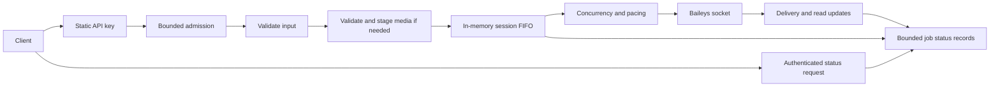

# Local message queue and worker operation

The Render service accepts validated message jobs, paces sends through its
Baileys session, and tracks execution separately from HTTP requests. It runs
without Redis, a database, or Cloudflare credentials. **The local queue and
its status records live in memory and are lost when the process exits.**

See [message request formats](MESSAGE_API.md), the
[README](../README.md), and the proposed
[Cloudflare integration](CLOUDFLARE_INTEGRATION.md).

## Processing architecture



Admission reserves capacity before a multipart upload is parsed. Validation
and complete media staging must succeed before a job is committed. A
reservation is not a sendable job. Rejected requests release their reservation
and clean up their files.

Each committed job has an ID, session, recipient, message metadata, payload,
creation time, attempt count, and state. Public job snapshots omit recipients,
message contents, local filenames, credentials, and QR data. Pending payloads
are released when execution and cleanup complete; status records have separate
count and age limits.

The HTTP worker currently serves one session named `default`. The queue
service supports independent session FIFOs, token buckets, and connection
states; exposing additional accounts requires session routing and authorization.
Changing `QUEUE_MAX_SESSIONS` does not create more WhatsApp accounts.

## Send and inspect a job

Every send still uses `POST /api/send`, the existing JSON or multipart fields,
and the `x-api-key` header. GET never sends a message.

```http
POST /api/send HTTP/1.1
Host: localhost:3000
x-api-key: YOUR_API_KEY
Content-Type: application/json

{"phone":"12025550123","message":"Hello from the queued worker"}
```

The default response is HTTP `202 Accepted` after input validation and any
media staging finish:

```json
{
  "success": true,
  "jobId": "5ed5825f-09ab-45a5-b75d-48cc933b0234",
  "status": "queued",
  "statusUrl": "/api/messages/5ed5825f-09ab-45a5-b75d-48cc933b0234"
}
```

The response also includes a `Location` header containing the status path.
Acceptance confirms local ownership of the job, not WhatsApp acceptance or
recipient delivery. A media request can take longer to accept because its
complete source is downloaded or uploaded and validated first.

Read status with the same key:

```powershell
curl.exe --request GET "http://localhost:3000/api/messages/5ed5825f-09ab-45a5-b75d-48cc933b0234" --header "x-api-key: YOUR_API_KEY"
```

Example after a send completes:

```json
{
  "success": true,
  "job": {
    "jobId": "5ed5825f-09ab-45a5-b75d-48cc933b0234",
    "sessionId": "default",
    "status": "sent",
    "attempts": 1,
    "createdAt": "2026-10-31T08:00:00.000Z",
    "updatedAt": "2026-10-31T08:00:01.000Z",
    "startedAt": "2026-10-31T08:00:00.000Z",
    "completedAt": "2026-10-31T08:00:01.000Z",
    "sentAt": "2026-10-31T08:00:01.000Z",
    "messageId": "EXAMPLE_WHATSAPP_MESSAGE_ID"
  }
}
```

Timestamps are UTC ISO strings. `startedAt` and `completedAt` are initially
`null`. Optional fields include `sentAt`, `deliveredAt`, `readAt`,
`nextAttemptAt`, `messageId`, and `error: { code, retryable }`. Errors expose
operational codes rather than raw exception messages. `attempts` counts
processing attempts, including attempts that stopped before calling Baileys.

Unknown or expired job IDs return `404`; malformed IDs and unsupported query
parameters return `400`. A `404` after a restart or retention expiry does not
prove that a message was never sent. Public IDs use letters, numbers,
underscores, and hyphens, start with a letter or number, and are at most
128 characters; normal HTTP submissions receive server-generated UUIDs.

## Migrate a synchronous caller

Existing request bodies remain compatible. Update callers that expected
HTTP `200` and a `messageId` immediately: store the `jobId` from HTTP `202`
and poll its status with a bounded delay. Do not repeat `POST /api/send`
because a job is still queued or because an HTTP response was lost.

For a temporary migration, request `POST /api/send?wait=true`, or set
`QUEUE_API_MODE=wait` for all requests. `wait=false` overrides the configured
mode for one request. These are the only supported send query parameters.

Waiting is bounded by `QUEUE_HTTP_WAIT_MS`, default 25 seconds. A completed
send returns HTTP `200` with the previous `success`, `phone`, and `messageId`
fields plus `jobId` and `status`. A pending job returns HTTP `202` with its
existing ID and current status. A known failure returns an error with the job
ID; an ambiguous outcome returns HTTP `502` and `status: "unknown"`.
Inspect that job before considering any further action. Waiting does not make
the queue durable or make `sent` mean recipient delivery.

## Status lifecycle

| State | Meaning |
| --- | --- |
| `queued` | Accepted, waiting for connection, capacity, or pacing |
| `processing` | One attempt is running; this alone does not imply bytes were sent |
| `retry_wait` | A safely retryable attempt failed before sending; its backoff is pending |
| `sent` | Baileys returned a send result, or an equally reliable tracked send result arrived |
| `delivered` | A recipient delivery acknowledgement was received |
| `read` | A read or played acknowledgement was received |
| `failed` | Permanent failure, exhausted safe retries, or job expiry |
| `cancelled` | Worker shutdown cancelled work that had not begun sending |
| `unknown` | Sending may have started, but its result cannot be established |

Typical progress is `queued -> processing -> sent -> delivered -> read`.
A safe pre-send failure follows `processing -> retry_wait -> processing`.
Missing acknowledgements leave a job at its last known state. Duplicate and
out-of-order acknowledgements cannot move `read` back to `delivered` or `sent`.
Late reliable acknowledgements can resolve an `unknown` outcome. Failed and
cancelled jobs are not revived by stale acknowledgements.

Delivery and read events depend on WhatsApp, recipient settings, and the
events made available by Baileys. A successful `sendMessage()` call does not
confirm recipient delivery. Message IDs are registered before sending so that
an acknowledgement arriving before the send promise resolves can be matched.
Unmatched acknowledgements have their own bounded count and expiry.

## FIFO, concurrency, and pacing

The default is one active send per session. Jobs start in FIFO order within
their session. A delayed retry stays at the head of that session and blocks
later jobs until it becomes eligible, succeeds, fails, or expires. Other
sessions can continue independently.

Increasing concurrency permits a configured number of simultaneous sends;
start order remains FIFO, but completion order need not. Keep concurrency at
one when sequential completion is required. There is no unbounded send fan-out.

Each attempt needs both a token and the minimum interval since the previous
attempt. Tokens refill continuously up to the configured burst capacity.
Backoff, pacing, disconnects, and concurrency limits all apply; whichever
requires the latest time wins. Timers and asynchronous operations do the
waiting without blocking the Node.js event loop.

The defaults are conservative operational settings for testing. They are
**not a safe WhatsApp sending rate and provide no guarantee against platform
restrictions**. Raising a limit does not change WhatsApp's policies or limits.

## Retry and disconnection policy

| Failure | Policy |
| --- | --- |
| Invalid input or invalid media | Reject before acceptance; do not enqueue |
| URL download or upstream validation failure during admission | Return an HTTP error and release the reservation; no accepted job exists |
| Temporary connection failure before sending | Pause while offline; retry only when explicitly classified safe |
| Permanent validation/source failure during an accepted attempt | `failed`; do not retry |
| Logged-out or failed authentication state | Stop sending, reject new admission, and fail queued work with `AUTHENTICATION_REQUIRED` |
| Failure after the send boundary, including a lost result | `unknown`; do not automatically resend |
| Job too old before another attempt | `failed` with `JOB_EXPIRED` |

The default permits two retries after the initial attempt. Before jitter,
backoff is `min(retryMaxMs, retryBaseMs * 2 ** (attempts - 1))`.
Jitter multiplies that delay by a random factor from
`1 - retryJitter` through `1 + retryJitter`; the final result is capped at
`retryMaxMs`. Defaults are a one-second base, 30-second cap, and 20% jitter.
Retries also obey normal pacing and the maximum job age.

A processing timeout aborts available resources. If a send promise does not
settle, the session keeps its occupied concurrency slot so that a late send
cannot overlap a replacement attempt. Its outcome becomes `unknown` after
the send boundary. Pending jobs can expire while waiting behind it; an
operator may need to restart the worker after reviewing the uncertainty.

The local worker prevents concurrent processing of the same retained ID.
This is not durable idempotency: forgotten IDs and process restarts remove
that protection. The public HTTP endpoint does not accept a caller-supplied
job ID or implement durable `Idempotency-Key` handling.

## Admission and media limits

`QUEUE_MAX_PENDING` is a **global unfinished-work capacity**, despite its
name: it counts admission reservations, queued jobs, active attempts, and
jobs whose cleanup or original send is still outstanding. The default is
100. Full capacity returns HTTP `429`; shutdown or a session requiring manual
authentication returns HTTP `503`. A rejected admission does not send work.
HTTP `429` responses include `Retry-After: 1`; callers should add their own
bounded backoff rather than retrying continuously.

Media is validated and copied into queue-owned temporary storage before
HTTP `202`. The worker therefore does not depend on a request-owned stream,
an upload file removed at response completion, or a URL remaining reachable
after acceptance. Temporary filenames are not part of public job records.

The staging budget defaults to 256 MiB and 32 files, including preparations
in progress. Remote sources reserve twice their per-type maximum during the
download-and-copy overlap; completed staging retains only the actual stored
bytes. Multipart parsing has a separate default maximum of one concurrent
upload and a 100 MiB per-upload ceiling. Per-message limits in
[the request guide](MESSAGE_API.md#limits-and-resource-handling) still apply.

Staged media expires after five minutes by default; pending jobs also have a
five-minute maximum age. Configuration requires the staging lifetime to be
at least the maximum job age.
Cleanup runs on rejection, completion, expiry, cancellation, and shutdown.
Expiring a file already being read does not start a replacement send.
Cleanup failures are counted; storage reservations remain held when removal
fails so that repeated failures cannot silently consume unlimited staging
capacity.

These budgets do not cap total process RSS or every byte of temporary disk.
Raw multipart uploads, source validation, image decoders, and Baileys'
encrypted media preparation can require additional transient resources.
Keep free disk and memory headroom and lower limits for small instances.

## Configuration reference

Environment variables are read when the worker is created. Invalid values
fail configuration validation instead of silently removing a limit. Except
where decimals are explicitly allowed, values must be whole numbers. Times
ending in `_MS` are milliseconds; sizes ending in `_BYTES` are bytes.

| Variable | Default | Allowed range or values | Purpose |
| --- | ---: | --- | --- |
| `QUEUE_API_MODE` | `queued` | `queued`, `wait` | Default HTTP acceptance behavior |
| `QUEUE_HTTP_WAIT_MS` | `25000` | 0-60000 | Maximum compatibility wait |
| `QUEUE_MAX_PENDING` | `100` | 1-10000 | Global unfinished-work slots |
| `QUEUE_MAX_SESSIONS` | `16` | 1-1000 | Maximum in-process session queues |
| `QUEUE_CONCURRENCY` | `1` | 1-16 | Active sends per session |
| `QUEUE_MIN_INTERVAL_MS` | `1000` | 0-3600000 | Minimum interval between attempt starts |
| `QUEUE_BURST_CAPACITY` | `1` | 1-100 | Token-bucket capacity per session |
| `QUEUE_REFILL_PER_SECOND` | `1` | 0.001-100, decimals allowed | Tokens added per second |
| `QUEUE_MAX_RETRIES` | `2` | 0-20 | Safe retries after the first attempt |
| `QUEUE_RETRY_BASE_MS` | `1000` | 1-3600000 | Initial retry backoff |
| `QUEUE_RETRY_MAX_MS` | `30000` | 1-3600000 | Maximum retry delay; at least the base |
| `QUEUE_RETRY_JITTER` | `0.2` | 0-1, decimals allowed | Retry delay variation |
| `QUEUE_MAX_JOB_AGE_MS` | `300000` | 1000-86400000 | Maximum age before a pending attempt starts |
| `QUEUE_JOB_TIMEOUT_MS` | `90000` | 1-3600000 | Deadline for one processing attempt |
| `QUEUE_STATUS_RETENTION` | `1000` | 1-100000 | Maximum completed status records |
| `QUEUE_STATUS_TTL_MS` | `3600000` | 1000-604800000 | Completed status retention age |
| `QUEUE_EARLY_ACK_LIMIT` | `1000` | 1-100000 | Maximum unmatched acknowledgements |
| `QUEUE_EARLY_ACK_TTL_MS` | `60000` | 1000-3600000 | Unmatched acknowledgement lifetime |
| `QUEUE_STAGING_MAX_BYTES` | `268435456` | 1-10737418240 | Media staging reservation budget |
| `QUEUE_STAGING_MAX_FILES` | `32` | 1-1000 | Staging file/preparation count |
| `QUEUE_STAGING_TTL_MS` | `300000` | 1000-86400000 | Staged media and admission reservation lifetime |
| `QUEUE_MAX_UPLOADS` | `1` | 1-32 | Concurrent admitted multipart requests |
| `QUEUE_PAYLOAD_MAX_BYTES` | `32768` | 1024-1048576 | Serialized metadata and payload per queued job |
| `QUEUE_DRAIN_MS` | `10000` | 0-300000 | Active-job shutdown drain window |

The retry maximum must be at least the retry base, and the staging lifetime
must be at least the maximum job age. These relationships are validated at
startup.

Set `API_KEY` to your own static key for standalone API authentication; there
is no built-in shared testing key. `PORT` continues
to select the HTTP port, defaulting to 3000 locally. The existing JSON parser
limit remains 32 KiB; increasing the internal queue payload limit does not
increase the HTTP body limit or any per-media limit.

Example PowerShell configuration for testing:

```powershell
$env:API_KEY = "YOUR_API_KEY"
$env:QUEUE_MAX_PENDING = "50"
$env:QUEUE_MIN_INTERVAL_MS = "2000"
$env:QUEUE_BURST_CAPACITY = "1"
$env:QUEUE_REFILL_PER_SECOND = "0.5"
npm start
```

## Health and monitoring

| Endpoint | Key required | Behavior |
| --- | --- | --- |
| `GET /live` | No | HTTP `200` while the HTTP process can respond |
| `GET /ready` | No | HTTP `200` when the worker can accept work and WhatsApp is ready; otherwise `503` |
| `GET /ping` | No | Existing WhatsApp readiness response retained: `200` connected, otherwise `503` |
| `GET /api/queue/stats` | Yes | Queue, session connection, upload, and staging metrics |
| `GET /api/messages/:jobId` | Yes | Sanitized retained status snapshot |

```powershell
curl.exe --request GET "http://localhost:3000/api/queue/stats" --header "x-api-key: YOUR_API_KEY"
```

The stats response is `{ "success": true, "queue": { ... } }`.
Important fields are:

| Field | Interpretation |
| --- | --- |
| `mode`, `durable` | `memory`, `false`; these jobs are process-local |
| `accepting`, `capacity`, `occupiedSlots`, `reservations` | Admission state, configured capacity, occupied unfinished slots, uncommitted requests |
| `pendingJobs`, `activeJobs`, `retryingJobs` | Current queued/retry-wait jobs, active executions, and retry-wait subset |
| `successfulSends`, `failedJobs`, `cancelledJobs`, `unknownOutcomeJobs` | Cumulative execution classifications since process start |
| `attempts`, `cleanupFailures` | Cumulative attempts and cleanup failures |
| `averageWaitingMs` | Average creation-to-first-attempt wait among jobs that started |
| `oldestPendingAgeMs` | Age of the oldest queued or retry-wait job; zero when none |
| `retainedStatuses`, `earlyAcknowledgements` | Current retained job snapshots and unmatched acknowledgements |
| `sessions` | Session IDs, connection states, connected flags, and current pending/active counts |
| `media`, `activeUploads` | Staging budgets and usage, open staging streams, and admitted multipart requests |

Cumulative counters are not current-state totals: a late acknowledgement can
resolve a previously unknown job without erasing its earlier execution
classification. Counters reset when the process restarts. Public health
responses expose no recipients, payloads, QR codes, credentials, or API keys.

The shared static key authorizes all local jobs. This is a trusted single-tenant
worker interface, not tenant isolation. Do not give this key directly to SaaS
customers; the future gateway must authorize tenant-scoped access.

## Graceful shutdown and crash behavior

On `SIGINT` or `SIGTERM`, stop admission and HTTP intake first. Cancel
unstarted queued/retry-wait jobs, stop unfinished admissions, and give active
attempts the configured drain window. After it expires, abort available
resources: pre-send work is cancelled and a send with an uncertain result is
marked `unknown`. Clear retry/wait timers, remove worker subscriptions, clean
staged media, then close the Baileys transport while preserving accepted
credential writes. Closing the transport does not log out the account.
The executable server also has a final shutdown deadline of the configured
drain window plus 15 seconds for a stuck external operation or credential
write. Forced exit at that deadline requires the same uncertain-send review
as an unexpected crash.

An unexpected crash loses **all local jobs, retry schedules, status records,
and duplicate-ID memory**. It may leave temporary files until the host's
temporary storage is reclaimed. A persistent auth directory preserves login,
not queued jobs. A send may already have reached WhatsApp when its local
result is lost. Recreating that message can produce a duplicate. There is no
exactly-once delivery guarantee, including after future durable coordination.

## Render deployment notes

These notes describe the **standalone in-memory queue**. For the existing
Cloudflare SaaS, use the [manual managed Render guide](RENDER_DEPLOYMENT.md),
including its Free/no-disk environment and recovery procedure. Managed mode
uses a file journal under `DATA_DIR`, not this standalone queue.

Use a Render Node web service with this repository's root as the service root,
`npm ci` as the build command, and `npm start` as the start command. Render
supports app-specific npm commands and expects the web service to listen on
the supplied `PORT` on an externally reachable host; the server uses that
port. See [Render Node/Express deployment](https://render.com/docs/deploy-node-express-app)
and [port binding](https://render.com/docs/web-services#port-binding).

Select Node 24 explicitly instead of depending on a service creation date's
runtime default. Render supports `NODE_VERSION`, `.node-version`, `.nvmrc`,
and bounded `package.json` engines ranges; use one source of truth. See
[Render Node versions](https://render.com/docs/node-version).

Set the Render HTTP health check path to `/live` so an unpaired or temporarily
disconnected WhatsApp session does not trigger repeated process restarts.
Monitor `/ready` separately and alert on persistent failure. Render treats
HTTP 4xx/5xx health responses as failures and can restart unhealthy instances.
This health-check choice is specific to the worker's need to remain available
for pairing and recovery. See [Render health checks](https://render.com/docs/health-checks).

Persist the directory that `config/socket.js` actually uses:
`<service-source-root>/auth`. For a native Node service rooted at Render's
standard source directory, that is `/opt/render/project/src/auth`; a nested
service root changes the path. Mount a persistent disk at the resolved auth
directory and verify write access at runtime. Only files under the mount
persist. Render's default filesystem is ephemeral, and a persistent disk is
restricted to one service instance and prevents zero-downtime deploys. See
[Render persistent disks](https://render.com/docs/disks). Archived auth backups
in the sibling `auth-backups` directory need a separate persistence plan if
they must survive a redeploy.

Run one process/socket owner per WhatsApp account. Do not use a process cluster
or scale identical replicas against the same auth directory. A persistent
auth disk does not make queue memory or temporary staging durable. Plan for
deploy interruptions and use the gateway ownership model before distributing
session work across servers.

## Capacity planning and maintenance

At default settings, pending payloads have a 100-slot global bound, completed
status retention has a separate 1000-record bound, and unmatched receipts have
a 1000-entry bound. Metadata/payloads are capped per job. These bounds do not
include Baileys' internal caches, decoded image memory, Node overhead, or
temporary encryption files. No fixed throughput or total-RSS guarantee is
claimed.

Status pruning and queue scheduling inspect the bounded in-memory sets.
Increasing job/session/status caps increases CPU work and memory. Scale after
measuring queue wait, oldest age, unknown outcomes, cleanup failures, disk
usage, and process memory under representative media sizes. Preserve FIFO
and uncertainty handling when replacing the local coordinator.

When queue behavior changes, update this reference, the message guide, README,
Postman examples, configuration validation, and tests together. Run `npm test`
with mocked Baileys; automated tests must never send real WhatsApp messages.
